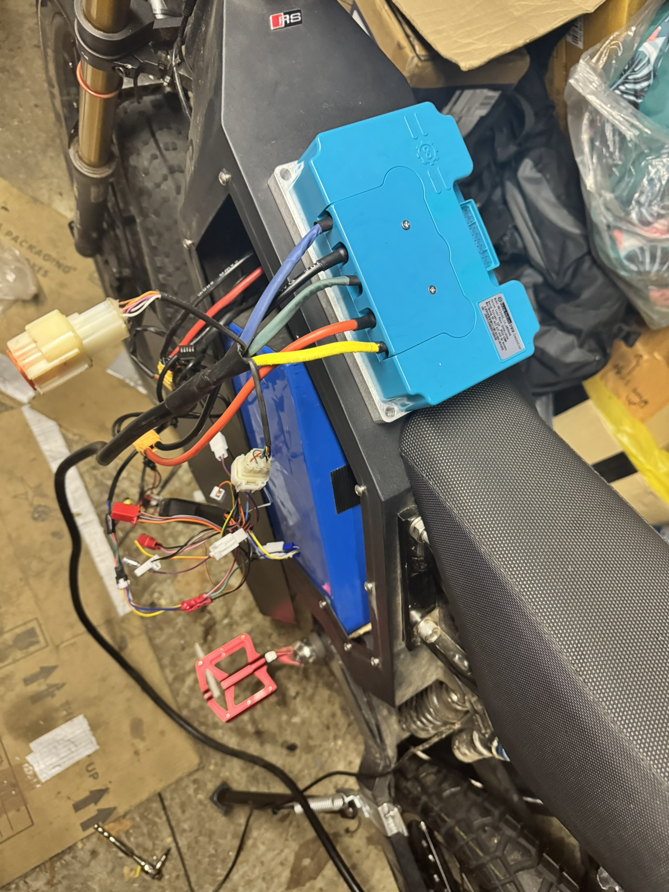

# Enduro E-Motorcycle Build

A full ground-up DIY 72V electric enduro motorcycle - frame, motor, battery, wiring and controller, built and iterated across three phases in a home garage. Every connection hand-made, every failure logged, every upgrade justified.

**Status:** Phase 2 complete - drivetrain bench-tested on the rig (autolearn done, wiring verified). First instrumented ride pending.

## Current spec

| System | Spec |
|---|---|
| Motor | QS Motor QS205 50H V3, 3.5T winding, rear hub (150 mm dropout) |
| Controller | Fardriver ND72450 - FOC sine wave, 200 A continuous / 450 A peak |
| Battery | NBPower 72 V 30 Ah (2.16 kWh), 100 A discharge |
| Peak electrical power | 32.4 kW (72 V × 450 A burst) |
| Wheel | 19" spoke rim, 80/100 enduro tyre |
| Brakes | Shimano MT501 hydraulic |
| Wiring | Fully crimped terminals (Phase 2 rework - no soldered joints in the loom) |
| Budget | ~£3,000+ across three phases, partially offset by donor-bike flipping |

## Build phases

| Phase | Description |
|-------|-------------|
| [Phase 0 - First Run](./phase-0-first-run/README.md) | Full first build from bare frame with budget drivetrain - proof of concept, first ride |
| [Phase 1 - Donor Bikes & Repairs](./phase-1-donor-bikes-and-repairs/README.md) | Donor bike teardowns, buy-to-fix repairs, and the dead-on-arrival Sabvaton controller |
| [Phase 2 - Fardriver Controller](./phase-2-fardriver/README.md) | QS205 + Fardriver ND72450 upgrade, full crimped rewire, throttle adapter, autolearn |

Each phase README is fully photo-documented - the build story, the wiring, the failures, and the fixes.

## Engineering documentation

| Folder | Contents |
|---|---|
| [`00-specification/`](./00-specification/PDS.md) | Product design spec and requirements tracking |
| [`01-calculations/`](./01-calculations/) | Power/torque, top speed, range, wiring gauge, thermal, braking, weight |
| [`02-trade-studies/`](./02-trade-studies/) | Motor, controller, battery, wheel and wiring-method decisions |
| [`04-bom/`](./04-bom/) | Per-phase bills of materials |
| [`05-testing/`](./05-testing/) | Test vs prediction, Fardriver tuning, performance logs |
| [`06-failure-log/`](./06-failure-log/failure-log.md) | Symptom → root cause → fix → retest, for every failure |
| [`07-firmware-config/`](./07-firmware-config/) | Fardriver parameter documentation |

## Three lessons that cost the most

1. **The 80 A generic controller bottlenecked a 100 A battery for the whole first build** - diagnosed, and removed entirely by the Fardriver upgrade.
2. **A secondhand Sabvaton controller arrived with shorted MOSFETs** - caught with a 10-second multimeter continuity check before it ever touched the battery.
3. **No two manufacturers agree on throttle wiring** - map every wire before crimping, then build an adapter harness.

---
*Part of my engineering portfolio - [alfred-leigh.co.uk](https://alfred-leigh.co.uk) | See also: [first-principles quadcopter design & build](https://github.com/a365l/quadcopter-project)*
