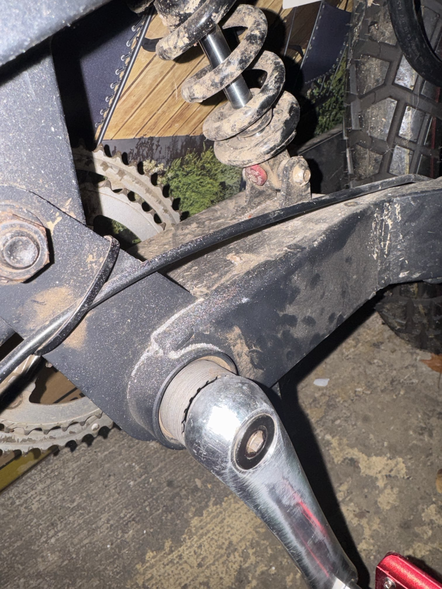
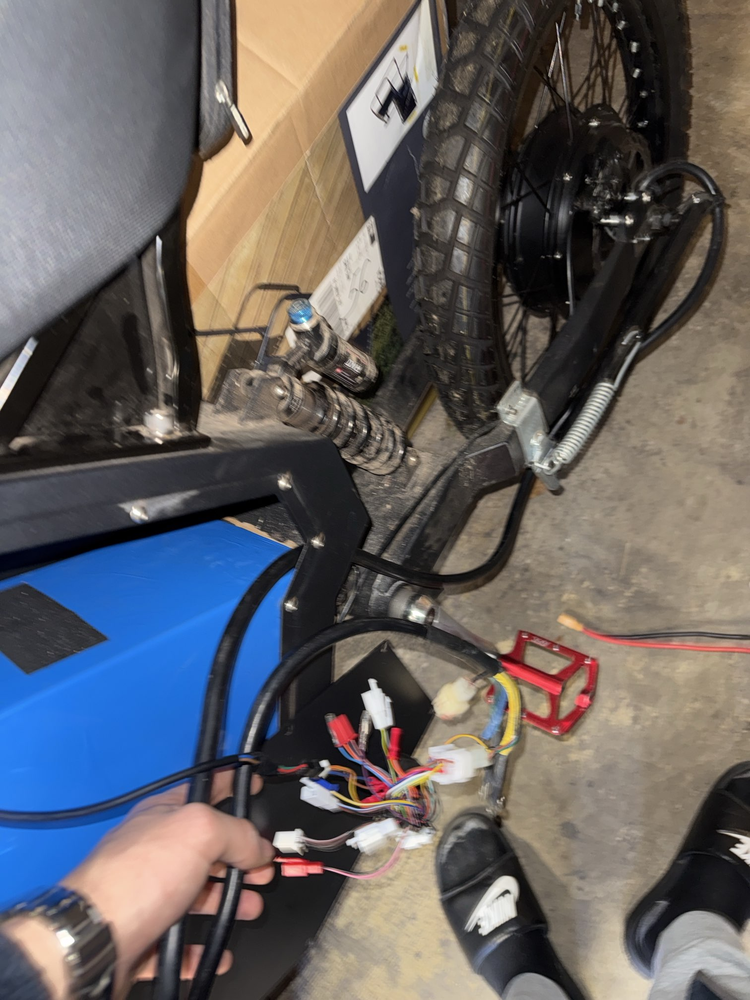
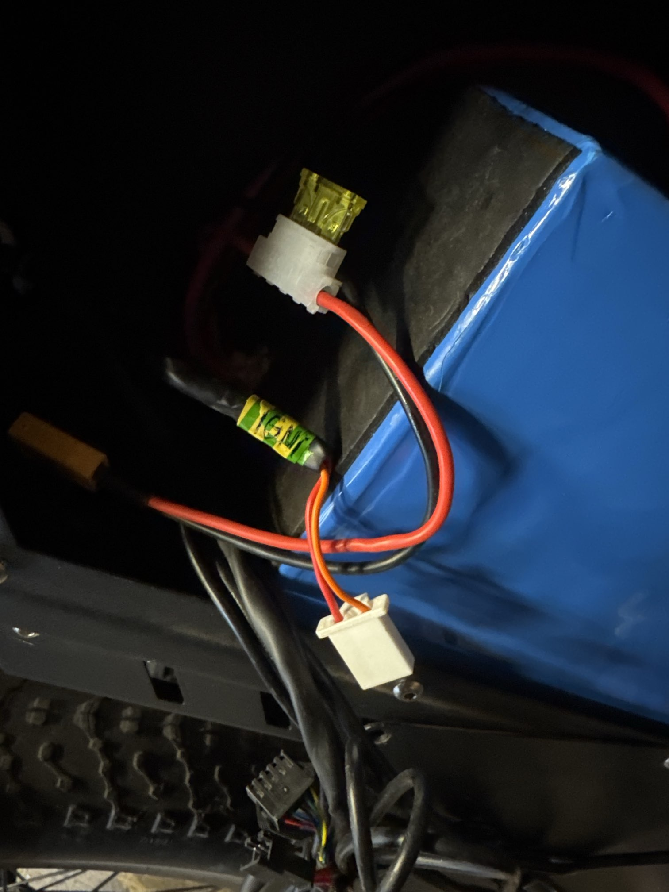

# Session Log — 21 Nov 2026

## What was done

Workshop session after the house move. Checked brake caliper rigidity, widened a frame hole, reviewed controller cooling and motor cable routing, then traced and tested the ignition key circuit. Everything was photographed for the build write-up.

## Progress

- [x] Rear caliper flex check: the caliper moves 1–2 mm under hard thumb pressure. The Shimano post-mount adapter sits on two separate 10 mm standoffs.
- [x] Frame hole widened with a carbide burr (7.94 × 19 × 6 mm cylindrical), run dry in drill mode on high speed
- [x] Controller cooling review: the heatsink was facing the battery pack
- [x] QS205 cable excess: plan to store it as a loose loop with slack for suspension travel
- [x] Ignition key traced to a white 3-pin plug with 2 wires (red/orange)
- [x] Key continuity test passed: a simple switch with no polarity
- [x] Key cable labelled `IGN`
- [ ] Wire the key: red → fused B+, orange → controller ignition
- [ ] Voltage test at the ignition pin
- [ ] Mill a one-piece caliper spacer block

## What worked

- Continuity test confirmed the key switch quickly
- Standard ebike key convention held: red = supply, orange = switched output

## What didn't work / issues found

- **Caliper mount:** two separate standoffs on bolts bend under braking load. The fix is a single milled spacer block, because a rotor spacer isn't possible (rotor already sits close to the hall cable).
- **Hall cable chafe:** the rotor has already chewed the hall/motor cable insulation
- **Controller heatsink facing the battery:** it heats the pack. Flip it to face the frame or move it outside the box.
- **No fuses on hand:** the ignition feed must be fused before riding
- **Charger blade fuse** is probably 32 V rated on a 72 V system

## Measurements / data taken

| Measurement | Value |
|---|---|
| Caliper standoff height | ~10 mm |
| Caliper deflection (hard thumb pressure) | ~1–2 mm |
| Key switch, key OFF (red–orange) | OL (open) |
| Key switch, key ON (red–orange) | Continuity |

## Caliper spacer block spec (to make)

- 6082/6061 aluminium or mild steel, 10 mm thick (measure the existing standoffs exactly)
- One piece spanning both adapter bolt holes, about 8 mm of material past each hole, 20–25 mm wide
- Faces milled flat and parallel. Holes positioned from the actual adapter.
- Grade 10.9 bolts, about 10 mm longer, Loctite 243, torqued properly

## Photos

| # | Photo |
|---|---|
| 01 |  Rear Shimano caliper on its post-mount adapter, lifted on two 10 mm standoffs |
| 02 |  Steel/paint dust from widening the frame hole with a carbide burr |
| 03 |  Battery box layout: NBPower pack, BMS and wiring |
| 04 |  QS205 motor cable with excess length to manage |
| 05 |  Tracing the ignition wiring: key barrel, fused charger feed, 8 AWG mains |
| 06 |  Key barrel cable running to the white 3-pin plug |
| 07 |  Signal harness bundle routed alongside the key cable |
| 08 |  Multimeter setup: COM and V/Ω/continuity input |
| 09 |  Key plug pinout: red (supply) and orange (switched), one empty slot |
| 10 |  Continuity test baseline: OL |
| 11 |  Key cable labelled `IGN` |

## Next session plan

1. Buy fuses rated ≥ 72 V DC (3–5 A ceramic 5×20 mm plus an inline holder) and self-amalgamating tape
2. Wire the ignition and run the voltage test (see [wiring key](../wiring-key.md))
3. Repair and reroute the hall cable
4. Flip or relocate the controller and log its temperatures on a test run
5. Mill the caliper spacer block

## Time spent

[X] hours
